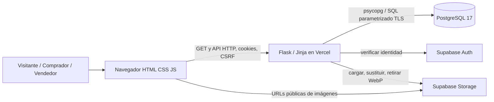

# Arquitectura vigente del sistema de vehículos usados

**Referencia:** `main` en `336bf7f` (V7.20.5), revisada para el cierre documental V7.21, 18-11-2026.  
**Alcance:** prototipo académico de publicación, consulta y contacto entre comprador y vendedor.  
**Documentos complementarios:** [Estado actual](ESTADO_ACTUAL.md) · [Evolución](EVOLUCION.md) · [Auditoría](auditoria-final-v721.md).

> Las decisiones y diagramas que describían un administrador compartido o chat anónimo de escritura pertenecen a V6 y anteriores. Esta página refleja **la arquitectura posterior a V7.9**.

## 1. Vista general

**Una sola aplicación Flask** concentra los contratos HTTP, autenticación contextual y permisos. El navegador no tiene acceso directo a PostgreSQL, no recibe secretos privados de Supabase y no decide quién es propietario de un anuncio. La interfaz usa HTML/CSS/JavaScript nativos; no hay ORM ni framework frontend. En Vercel, el código se ejecuta como función Flask sobre Python 3.14, mientras los recursos bajo `public/static/` se sirven como estáticos.

## 2. Responsabilidades y separación

| Capa / archivo | Función vigente |
| --- | --- |
| `app.py` | Flask, plantillas, API HTTP, sesión, CSRF, restricciones de entorno y autorización. |
| `vehiculos.py`, `tipos_vehiculo.py` | Esquema lógico de datos, validación, normalización, conversiones y tipos. |
| `persistencia.py` | SQL de catálogo, publicaciones, disponibilidad y consultas transaccionales. |
| `persistencia_fotos.py` | Referencias de fotografías, reservas, sustituciones, eliminaciones y cola de limpieza. |
| `imagenes.py` | Decodificación, verificación de límites y recodificación WebP sin metadatos. |
| `almacenamiento.py` | Adaptador REST de Storage y mantenimiento de objetos. |
| `cuentas.py`, `auth_proveedor.py`, `nombres_usuarios.py` | Identidad, sesión, rol y perfil visible fijo al registrarse. |
| `persistencia_chat_cuentas.py` | Conversaciones autenticadas, mensajes, participantes y consultas idempotentes. |
| `perfiles_publicos.py` | Obtención delimitada de perfiles de vendedores. |
| `archivo_chat.py` | Archivo histórico de chats anónimos de solo lectura bajo permisos del vendedor. |
| `templates/`, `static/` | Pantallas, estilos y comportamiento del cliente. |
| `public/static/` | Copias de recursos que Vercel entrega por CDN; sincronizadas con `static/`. |

Algunos nombres heredados del frontend contienen `admin-v6`. **El nombre del archivo no implica un rol administrativo global activo**: son componentes reutilizados por el vendedor. `persistencia_chat.py` sigue conteniendo validadores y persistencia histórica necesarios para compatibilidad/archivo, no rutas públicas de escritura anónima.

## 3. Modelo de datos

PostgreSQL 17 es la **fuente de verdad**. Las tablas y migraciones versionadas se encuentran en `supabase/migrations/`. Descripción conceptual:

- **Vehículos:** identificador generado por PostgreSQL, marca, modelo, año, kilometraje, precio en centavos de USD, ubicación, descripción, disponibilidad, ficha técnica, timestamps, propietario `vendedor_id` cuando corresponda y retiro lógico.
- **Fotografías:** hasta cinco referencias ordenadas por anuncio; cada referencia asocia una ruta de objeto WebP, metadatos y un vehículo. Los binarios no se guardan en la base.
- **Identidades/perfiles/roles:** UUIDs vinculados a Supabase Auth; rol y nombre visibles definidos al registrar, con reglas de inmutabilidad actuales.
- **Conversaciones y mensajes:** relación de participantes comprador/vendedor y vehículo, historial privado, estados y claves de idempotencia.
- **Coordinación:** solicitudes idempotentes, operaciones de imágenes y cola de limpieza recuperable, además de mecanismos de revocación o limitación que requieran las rutas vigentes.
- **Histórico V6:** conversaciones anónimas previas que pueden leerse mediante el archivo autorizado; no representan un nuevo canal de escritura.

Las operaciones se realizan con funciones Python y SQL parametrizado por psycopg. Se usa TLS hacia PostgreSQL remoto. Las credenciales privilegiadas permanecen en el servidor; las tablas expuestas por el modelo tienen RLS y privilegios públicos revocados conforme a sus migraciones. No se abren políticas de lectura/escritura directa a clientes solo para suprimir avisos del proveedor.

Los datos públicos se **proyectan deliberadamente**: una consulta del catálogo no entrega la placa privada ni atributos internos de identidad. La consulta del perfil público entrega nombre, URL y las publicaciones autorizadas; no correo, credenciales o atributos privados.

## 4. Autenticación, roles y permisos

La arquitectura vigente tiene **visitante, comprador y vendedor**:

1. Un visitante puede consultar catálogo, fichas y perfiles sin credenciales.
2. El comprador usa Supabase Auth para iniciar sesión y contactar desde un vehículo disponible. Solo accede a conversaciones donde participa.
3. El vendedor autenticado puede publicar y operar exclusivamente sobre vehículos de su propiedad, y leer/responder los hilos correspondientes.
4. Los cambios de propietario no se aceptan desde el cuerpo enviado por el cliente; se comprueban contra identidad y relaciones persistidas.
5. El nombre visible se selecciona en el registro y permanece fijo desde V7.10. El rol no cambia mediante metadata editable de Auth.
6. Al cerrar sesión o cambiar de identidad, el frontend invalida las vistas privadas y el backend verifica la sesión para cada ruta que lo requiere.

Las escrituras exigen **CSRF** y contexto autenticado autorizado. Las cookies se configuran con atributos de seguridad; las respuestas privadas y las relacionadas con el token CSRF no deben almacenarse en caché compartida. Los parámetros de retorno están validados para evitar navegación a orígenes externos.

La transición V7.9 eliminó el login global por contraseña y las rutas `/api/admin/*`. `/administracion` redirige a `/cuenta`, y las cookies administrativas heredadas no conceden permisos. También se retiraron las rutas HTTP de escritura del chat anónimo V6. El archivo de mensajes históricos mantiene control de identidad/propiedad y es **solo lectura**.

## 5. Consistencia de publicaciones y fotografías

- La publicación se crea/actualiza de forma transaccional en PostgreSQL. El servidor, no el navegador, asigna el identificador y comprueba autorización.
- La idempotencia mediante UUID y huella impide duplicar altas/fotos tras un doble clic, un reintento o una respuesta perdida; el reuso incompatible se rechaza.
- Cada anuncio admite hasta cinco fotografías. El navegador acepta originales JPEG/PNG/WebP de hasta **10 MB** y prepara WebP de un máximo de **1600 px** y **1 MB**; Flask limita la solicitud y **vuelve a validar y recodificar**, eliminando metadatos.
- Para sustituir una imagen, se reserva una operación en base, se carga a **una ruta nueva** y posteriormente se confirma su referencia. La antigua permanece hasta que se puede reclamar con seguridad para limpieza.
- Eliminar una foto retira su referencia y registra el trabajo de limpieza en el mismo commit. Los fallos conservan una cola recuperable.
- No existe una transacción distribuida entre PostgreSQL y Storage. Se usan reservas durables, bloqueo de filas y concesiones de limpieza para disminuir riesgos de datos y objetos inconsistentes.

La imagen pública puede mostrar una matrícula visible dentro de la foto aunque el campo placa sea privado. El equipo debe revisar los archivos ficticios antes de publicarlos.

## 6. Interfaz y navegación

- Catálogo compartido con texto, filtros y orden.
- Fichas enlazables y galería de hasta cinco fotos, con miniaturas y controles V7.20.
- Perfiles públicos de vendedores y enlaces a otras publicaciones.
- Cuentas: inicio/registro, identidad y navegación por rol.
- Compradores: contacto contextual desde anuncio, bandeja e historial.
- Vendedores: inventario, alta/edición, fotografías, disponibilidad, retiro y respuesta de mensajes.

La interfaz prioriza la continuidad: contacto recuperado tras login, retorno al catálogo/perfil/inventario según el origen y protección de cambios sin guardar. El contenido de mensajes se inserta como texto, sin interpretar HTML del usuario.

## 7. Ambientes, despliegue y comprobación

- **Local y pruebas:** Flask + PostgreSQL 17 loopback aislado para integraciones; dobles de Supabase Auth/Storage donde se necesita aislamiento.
- **Preview:** barrera de solo lectura forzada desde servidor; no habilitar escrituras por un cambio de variable accidental. En V7.21 esa política se comprobó localmente, **no en una Preview remota**.
- **Production:** `https://sistema-vehiculos-usados.vercel.app/`. La auditoría confirmó READY de `main` en `336bf7f` y navegación pública con fotografía WebP. **No** se probaron escrituras ni sesiones privadas reales en esa auditoría.
- **Archivos estáticos:** Flask referencia `/static/`; las copias de `public/static/` deben mantenerse idénticas mediante `scripts/preparar_vercel.py`.

El cierre funcional se determinó mediante V7.21: 28 pruebas localizadas y 8 pruebas PostgreSQL, además de recorridos de navegador. El resultado **APTO CON OBSERVACIONES** no acredita una auditoría de seguridad completa ni uso comercial.

## 8. Límites de diseño y decisiones históricas

La elección de Flask + SQL + JavaScript nativo responde al alcance académico; una reescritura en PHP, microservicios, arquitectura de red social o pagos no forma parte del objetivo. Los documentos de V6, V7.1–V7.8 y los informes de avance preservan condiciones históricas de aquellas entregas y no deben utilizarse para reactivar permisos retirados.

**Sin operaciones remotas autorizadas por esta documentación:** leer o actualizar estas páginas no habilita migraciones, limpiezas, escrituras en Supabase, cambios en Vercel ni publicación de cuentas de demostración. Para tareas operativas consultar [README](../README.md) y [AGENTS](../AGENTS.md).
