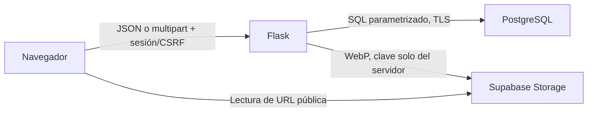

# Arquitectura vigente

Aplicación estructurada de catálogo compartido: Python/Flask, PostgreSQL 17, Supabase Storage y frontend HTML/CSS/JavaScript sin compilador. El proyecto remoto autorizado es `rtcygltmrtulyeezaaac`, `us-west-2`. El estado comprobado de los servicios y el despliegue se registra en `AVANCE_02.md`.

## Responsabilidades

| Archivo | Responsabilidad |
| --- | --- |
| `vehiculos.py` | Validación/normalización pura, Decimal a centavos y exportaciones antiguas. |
| `persistencia.py` | Conexión psycopg, CRUD, IDs de PostgreSQL, límite 500, idempotencia, semillas e importación. |
| `persistencia_fotos.py` | Metadatos, máximo cinco, reservas durables, sustitución, eliminación y reclamación de limpieza. |
| `limites_login.py` | Ventanas compartidas de intentos, reservadas atómicamente antes del hash. |
| `imagenes.py` | Decodificación Pillow, límites, orientación y WebP nuevo sin metadatos. |
| `almacenamiento.py` | REST de Storage, URLs públicas, errores seguros y procesamiento de cola. |
| `app.py` | Flask, contratos HTTP, sesión, CSRF, autorización y modo de consulta. |
| `static/js/interfaz.js` | Formularios, galería, administración y HTTP; conserva UUID ante resultados inciertos. |
| `static/js/fotografias.js` | Compresión y vista previa de un archivo por vez en navegador. |

No hay ORM, colección global de anuncios, persistencia en archivos de aplicación ni clases de dominio. Los dobles en pruebas no sustituyen PostgreSQL en producción.

## Modelo relacional

`public.vehiculos`: id BIGINT IDENTITY PK; marca/modelo VARCHAR(60), año SMALLINT, kilometraje/precio_centavos BIGINT, ubicación VARCHAR(100), descripción VARCHAR(1000), disponibilidad disponible/vendido y timestamps. Campos opcionales: color(40), placa(20), tipo(40), transmisión/combustible(30) y tres BOOLEAN nullable. USD permanece como moneda y los enteros se restringen al rango seguro de JavaScript. Python valida año 1900 hasta año actual +1; SQL conserva el mínimo estático. `updated_at` se actualiza desde las consultas, sin trigger.

`public.vehiculo_fotografias`: IDENTITY PK; vehículo FK ON DELETE RESTRICT; ruta única; orden 1..5 y UNIQUE(vehiculo_id,orden); MIME image/webp; tamaño 1..1.000.000; dimensiones 1..1600; timestamp. Los índices de PK/UNIQUE cubren búsquedas por vehículo y restricciones. No contiene binarios ni Base64.

Tablas auxiliares privadas al API público:

- `admin_login_intentos`: clave HMAC, número de intentos y expiración; índice por expiración y limpieza acotada de ventanas de más de un día.
- `solicitudes_idempotentes`: UUID de alta, huella del cuerpo normalizado y FK al vehículo. Reutilizar clave con datos distintos se rechaza.
- `fotografia_operaciones`: UUID, vehículo, foto objetivo/resultado, ruta anterior/nueva, huella y estado pendiente/completada/cancelada. Una reserva caduca después de una hora.
- `storage_limpieza`: ruta, instante elegible y concesión `reclamada_hasta`; trabajo durable para objetos sin referencia.

RLS está habilitado en las seis tablas y se revocaron privilegios a PUBLIC/anon/authenticated. No hay políticas públicas. Las lecturas públicas pasan por Flask y la conexión privilegiada permanece en el servidor. Los avisos INFO RLS sin políticas reflejan ese cierre; no se añaden políticas abiertas para silenciarlos.

## Consistencia e idempotencia

Las altas bloquean la tabla para comprobar el límite de 500 e insertar la solicitud idempotente en la misma transacción. PostgreSQL genera los IDs. Las fotos bloquean la fila del vehículo, por lo que altas concurrentes no superan cinco órdenes ni duplican una clave de envío.

Proceso de carga/sustitución:

1. Python decodifica y recodifica la imagen; deriva su huella.
2. PostgreSQL reserva UUID/ruta y deja recuperación durable antes de enviar bytes.
3. Se sube a una ruta nueva, sin upsert. Un 409 solo se acepta tras descargar y comparar bytes mediante tamaño y SHA-256.
4. PostgreSQL confirma metadatos, estado completado y cola para el objeto anterior en una sola transacción. Una sustitución concurrente incompatible falla sin eliminar la foto vigente.
5. Tras el commit se intenta procesar una tarea de limpieza. Un error conserva la cola y se informa como limpieza pendiente, sin deshacer el cambio válido.

Eliminar una foto retira su referencia y encola el objeto en el mismo commit; no borra primero el objeto. La previsualización de limpieza no modifica datos. Cada borrado real requiere reclamar la ruta con bloqueos en orden operación→cola y una lectura actual. La reclamación cancela una reserva expirada antes de autorizar el borrado, excluye referencias activas y usa una concesión de dos minutos. Así una confirmación que cruza el vencimiento no puede competir con el borrado. Un crash deja una reserva o cola recuperable, no exige borrar fotografías anteriores por suposición.

No hay transacción distribuida entre PostgreSQL y Storage. Los objetos huérfanos son recuperables mediante la cola y el comando de mantenimiento. No se barre todo el bucket.

## HTTP y seguridad

Los contratos completos están en README. GET lista/item devuelve fotos y omite placa sin sesión. POST/PUT de anuncios recibe solo `{vehiculo}`; PATCH recibe `{disponibilidad}`. POST alta y POST/PUT de fotos exigen UUID. Fotos usan multipart individual; DELETE se autoriza igual que otras escrituras. Errores: JSON `ok=false,mensaje,errores?`; el cliente no recibe trazas, DSN ni mensajes internos de proveedores.

Sesión Flask firmada con clave de entorno; contraseña scrypt de entorno, máximo 1024 caracteres antes del hash; cookie HttpOnly/SameSite=Lax y Secure en HTTPS/Vercel. Cada mutación requiere CSRF. El token rota al entrar/salir. Página/API usan no-store y nosniff. No hay sesiones administrativas almacenadas en memoria de un worker.

El límite es cinco intentos por diez minutos para HMAC(remote_addr), reservados atómicamente en PostgreSQL y liberados tras acceso correcto. No depende de cookies ni confía en X-Forwarded-For arbitrario. Si un proxy concentra varias direcciones, el límite será conservador y compartido. No reemplaza MFA ni atribución individual; la administración sigue siendo compartida.

El navegador acepta originales de hasta 10 MB y prepara WebP ≤1600 px, calidad inicial 78 y ≤1 MB. Flask limita cada solicitud a 1.1 MB, solo acepta un archivo, rechaza animaciones/corrupción y vuelve a codificar sin EXIF/ICC/XMP. Una clave secreta moderna viaja solo en apikey; el JWT service_role heredado usa apikey/Bearer. HTTPS es obligatorio y se rechazan redirecciones para no reenviar secretos.

## Ambientes y Vercel

Desarrollo usa `.env` ignorado. PostgreSQL remoto siempre requiere TLS, con prepared statements desactivados para Transaction Pooler. La excepción sin TLS exige opt-in y loopback fijo; rechaza redirecciones hostaddr/service del destino local.

Vercel detecta `app.py:app`, usa Python 3.14 y una función con 60 segundos. Los recursos referenciados por las plantillas se versionan en `public/static/` para servirlos por CDN; `scripts/preparar_vercel.py` sincroniza esas copias desde `static/`. No hay fotos ni datos persistentes en el disco de Vercel. Preview es siempre de solo lectura, aun con APP_READ_ONLY=false. Production necesita variables propias y aprobación final. No existe promoción ni push implícito.

Las pruebas reales crean bases PostgreSQL locales nuevas con UUID. Storage remoto requiere credenciales y una verificación autorizada separada: los dobles y el arnés de navegador no acreditan una carga al servicio. La evidencia distingue esos alcances.
