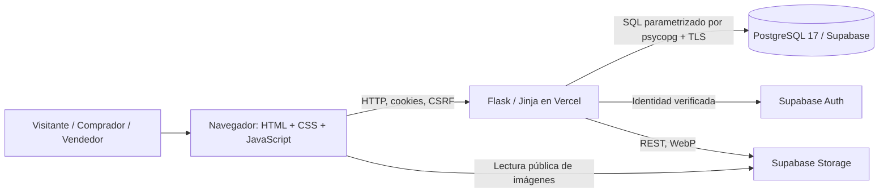

# Estado actual del proyecto — cierre funcional V7.21

**Corte documental:** 18 de noviembre de 2026.  
**Repositorio:** `carlosbenavides23/sistema-vehiculos-usados` · Grupo 7, Programación Estructurada, Universidad Americana (UAM), Managua.  
**Código de referencia:** `main`, commit `336bf7f3834c11caae0cd9e96d6417a090ff5715` (corrección V7.20.5).  
**Auditoría de aceptación:** V7.21, **APTO CON OBSERVACIONES**. V7.21 identifica la auditoría, no una versión de código desplegada.  
**Sitio público:** https://sistema-vehiculos-usados.vercel.app/

## 1. Propósito y alcance

El producto es un **prototipo académico funcional** para publicar, consultar y gestionar anuncios de vehículos usados y permitir el contacto entre compradores y vendedores. No pretende ofrecer todas las garantías ni los servicios de una plataforma comercial de compraventa. Su criterio de cierre es que los recorridos esenciales funcionen de manera consistente, con almacenamiento persistente y controles de acceso adecuados al alcance definido.

El desarrollo de nuevas funcionalidades queda **congelado para la presentación**. Solo se justifican correcciones por defectos reproducibles que bloqueen recorridos esenciales, afecten la integridad de datos o comprometan seguridad. Esto es una decisión de cierre del equipo, no una limitación impuesta por el software.

### Roles y recorridos

| Actor | Capacidades actuales |
| --- | --- |
| Visitante | Consultar catálogo, realizar búsquedas y filtros, ver fichas, fotografías y perfiles públicos de vendedores. Puede dirigirse al acceso cuando intenta contactar. |
| Comprador autenticado | Consultar catálogo y perfil, contactar al vendedor desde un anuncio disponible, abrir «Mis conversaciones», enviar y recuperar mensajes privados. |
| Vendedor autenticado | Administrar únicamente sus anuncios, crear y editar publicaciones, gestionar fotografías, cambiar disponibilidad, retirar publicaciones y responder conversaciones vinculadas a su inventario. |

El nombre visible se elige al registrar la cuenta y queda **fijo** desde V7.10; el rol también es inmutable mediante las reglas vigentes. Un comprador sin destino contextual inicia sesión y vuelve al catálogo; el vendedor entra a su panel. Un contacto desde una ficha puede recuperar ese contexto después del inicio de sesión.

## 2. Funcionalidades implementadas

### Catálogo y fichas públicas

- Catálogo compartido sin necesidad de cuenta.
- Búsqueda de texto y filtros combinables, entre ellos disponibilidad, precio, año y tipo; orden por precio o año.
- Ficha individual enlazable con marca, modelo, año, ubicación, descripción y atributos técnicos opcionales.
- Datos como color, tipo, transmisión, combustible, motor, versión, puertas, pasajeros y equipamiento triestado («Sí», «No» o «No especificado») cuando están informados.
- Galería de hasta **cinco fotografías**; la presentación V7.20 prioriza la imagen, conserva su encuadre y permite navegar con miniaturas cuando hay varias.
- Perfil público del vendedor con nombre y anuncios visibles. Los vehículos vendidos permanecen consultables; los retirados dejan de mostrarse en el catálogo público.
- Protección de datos: la placa no se expone en el contrato público; las APIs de perfiles no proporcionan correo ni credenciales. Una placa captada en una fotografía pública debe ocultarse antes de subirla.

### Cuenta e identidad

- Registro e inicio de sesión de compradores y vendedores mediante **Supabase Auth** a través de Flask.
- Rol y nombre visibles establecidos al registrarse y verificados desde el servidor; la metadata del navegador no concede permisos.
- Sesiones seguras, caducidad y revocación; cierre de sesión con limpieza de estados privados y coherencia entre pestañas.
- Navegación contextual entre catálogo, fichas, cuenta, panel vendedor y conversaciones.
- Transiciones de carga en login y panel para evitar mostrar vistas incorrectas mientras se comprueba la sesión.

### Operaciones del vendedor

- Inventario propio con búsqueda y filtro de disponibilidad.
- Alta de anuncios con validaciones de campos obligatorios y opcionales.
- Edición persistente; protección al salir con cambios pendientes.
- Marcado disponible/vendido y reversión conforme a las reglas vigentes.
- Retiro lógico de publicaciones conservando el historial autorizado.
- Fotografías: selección, previsualización, carga, sustitución y eliminación. El vehículo se guarda antes de añadir sus fotografías.
- Idempotencia en altas y cargas para manejar clics repetidos y respuestas perdidas.

### Mensajería privada

- Conversaciones autenticadas comprador–vendedor asociadas a vehículos.
- Bandeja para cada participante, recuperación del historial y respuesta desde el panel correspondiente.
- Envío con Enter y salto de línea con Shift+Enter; reintentos idempotentes sin duplicar mensajes.
- Lectura limitada a participantes autorizados; los hilos de anuncios retirados conservan historial, sin nuevas escrituras según su estado.

El **chat anónimo** y el **login administrativo compartido** pertenecen a la historia del sistema; sus rutas de escritura ya no forman parte de la interfaz vigente. La ruta `/administracion` redirige a `/cuenta`. Existe un archivo de conversaciones anónimas históricas, de solo lectura, bajo el ámbito de vendedor autorizado; no debe presentarse como un chat activo.

## 3. Arquitectura implementada

- **Backend:** Python 3.14 en despliegue, Flask y funciones modulares; Jinja para vistas. No se usa ORM ni un framework frontend.
- **Base de datos:** PostgreSQL 17, fuente de verdad de vehículos, propietarios, perfiles, fotografías, coordinación e historial de mensajes.
- **Identidad:** Supabase Auth; Flask comprueba usuario, rol, sesión y propiedad antes de las operaciones restringidas.
- **Imágenes:** WebP en Supabase Storage, bucket `vehiculos`. El navegador prepara las imágenes y Python las valida y recodifica. Los metadatos de referencia residen en PostgreSQL, no los binarios.
- **Despliegue:** Vercel para la aplicación Flask y el contenido estático versionado en `public/static/`, sincronizado con `static/`. Los discos de funciones no se usan como almacenamiento persistente.
- **Preview:** las reglas del servidor fuerzan solo lectura, independientemente de una bandera que intente habilitar escrituras.

### Módulos principales

| Componente | Función |
| --- | --- |
| `app.py` | Rutas HTTP, vistas, controles de sesión, CSRF y autorización. |
| `vehiculos.py` / `tipos_vehiculo.py` | Validación y normalización de datos y tipos. |
| `persistencia.py` / `persistencia_fotos.py` | Anuncios, propiedad, consistencia e información de fotografías. |
| `cuentas.py` / `auth_proveedor.py` | Cuentas, roles e integración de autenticación. |
| `persistencia_chat_cuentas.py` | Persistencia y permisos de mensajería autenticada. |
| `imagenes.py` / `almacenamiento.py` | Procesamiento y operaciones sobre fotografías. |
| `perfiles_publicos.py` | Consultas acotadas de perfiles de vendedores. |
| `static/` / `public/static/` / `templates/` | Interfaz y recursos servidos por Flask/Vercel. |

Los módulos cuyos nombres contienen «admin» o «chat» pueden conservar identificadores históricos sin que eso implique permisos globales ni chat anónimo de escritura vigentes.

## 4. Seguridad e integridad verificadas

- Autorización por **rol, identidad y propietario** en Flask/SQL; no depende de esconder botones.
- Mutaciones protegidas con CSRF y sesiones verificadas; cookies con atributos de seguridad y respuestas privadas sin caché.
- RLS habilitado y privilegios directos revocados para roles públicos del acceso a datos utilizado.
- Parámetros de retorno validados para evitar redirecciones externas.
- Reintentos con UUID/huella de contenido y comprobaciones transaccionales para evitar duplicaciones.
- Fotografías: archivos originales JPEG/PNG/WebP de hasta 10 MB, preparación WebP en navegador (máximo 1600 px / 1 MB) y recodificación en servidor; hasta cinco por publicación.
- Sustitución y borrado de fotografías coordinados con PostgreSQL y cola recuperable: **no existe transacción distribuida** entre Storage y PostgreSQL; los fallos parciales se recuperan mediante operaciones durables y mantenimiento.
- Pruebas aisladas de concurrencia en retiro/edición y retiro/reserva fotográfica.

Estas medidas describen la implementación y la cobertura conocida. **No equivalen a una certificación de seguridad ni a una garantía de producción comercial.**

## 5. Evidencia del cierre V7.21

La auditoría del 18 de noviembre examinó el commit `336bf7f`:

| Evidencia | Resultado |
| --- | --- |
| Despliegue público Vercel | READY y correspondiente al commit auditado. |
| Production sin autenticación | Inicio, recursos, búsqueda Toyota, ficha con WebP y perfil público: aprobados. |
| Recorridos completos de visitante/comprador/vendedor | Completados; los privados, en entorno local aislado. |
| Pruebas automatizadas localizadas | 28 de cuentas/chat/Preview y 8 con PostgreSQL 17 aislado: aprobadas. |
| Defectos confirmados en escenarios auditados | Ninguno P0/P1; tampoco P2/P3 confirmado en los recorridos verificados. |
| Veredicto | **APTO CON OBSERVACIONES**. |

**Límite de evidencia crucial:** las pruebas autenticadas usaron identidades y Storage simulados con PostgreSQL local aislado. La auditoría remota solo hizo consultas públicas. La creación de cuentas, el chat y las escrituras reales contra Auth/Storage/PostgreSQL de Production **no fueron validados en esa auditoría**. Tampoco se probó un Preview remoto real.

La auditoría no equivale a una nueva versión funcional V7.21. El detalle se conserva en [Auditoría V7.21](auditoria-final-v721.md).

## 6. Trabajo de cierre, no de desarrollo

1. Preparar cuentas y datos ficticios de demostración sin afectar publicaciones de terceros.
2. Verificar manualmente en Production los flujos autenticados pertinentes, con autorización y datos de prueba controlados.
3. Ensayar tres recorridos: visitante consulta; comprador contacta; vendedor publica/edita y responde.
4. Comprobar antes de exponer que el sitio y los archivos siguen disponibles.
5. Congelar nuevas funcionalidades y despliegues innecesarios hasta la presentación.

**Fuera del alcance:** pagos, compraventa formal, certificación mecánica, moderación comercial, reputación, recomendaciones algorítmicas y red social. Tampoco se acredita capacidad de producción a gran escala.

## 7. Lecturas relacionadas

- [Evolución del proyecto](EVOLUCION.md): etapas, decisiones, cambios de arquitectura y PR históricos.
- [Auditoría final V7.21](auditoria-final-v721.md): escenarios, observaciones y límites de verificación.
- [Arquitectura](ARQUITECTURA.md), [decisiones](DECISIONES.md) y [roadmap](ROADMAP.md): antecedentes y documentación técnica.
- [README](../README.md) e [instrucciones para agentes](../AGENTS.md): instalación y operaciones.

> **Criterio de interpretación:** si una nota histórica afirma que el chat o las cuentas aún no existen, o describe un administrador global, corresponde a una etapa anterior; este documento y el código `main` auditado prevalecen para describir el estado funcional al 18-11-2026.
